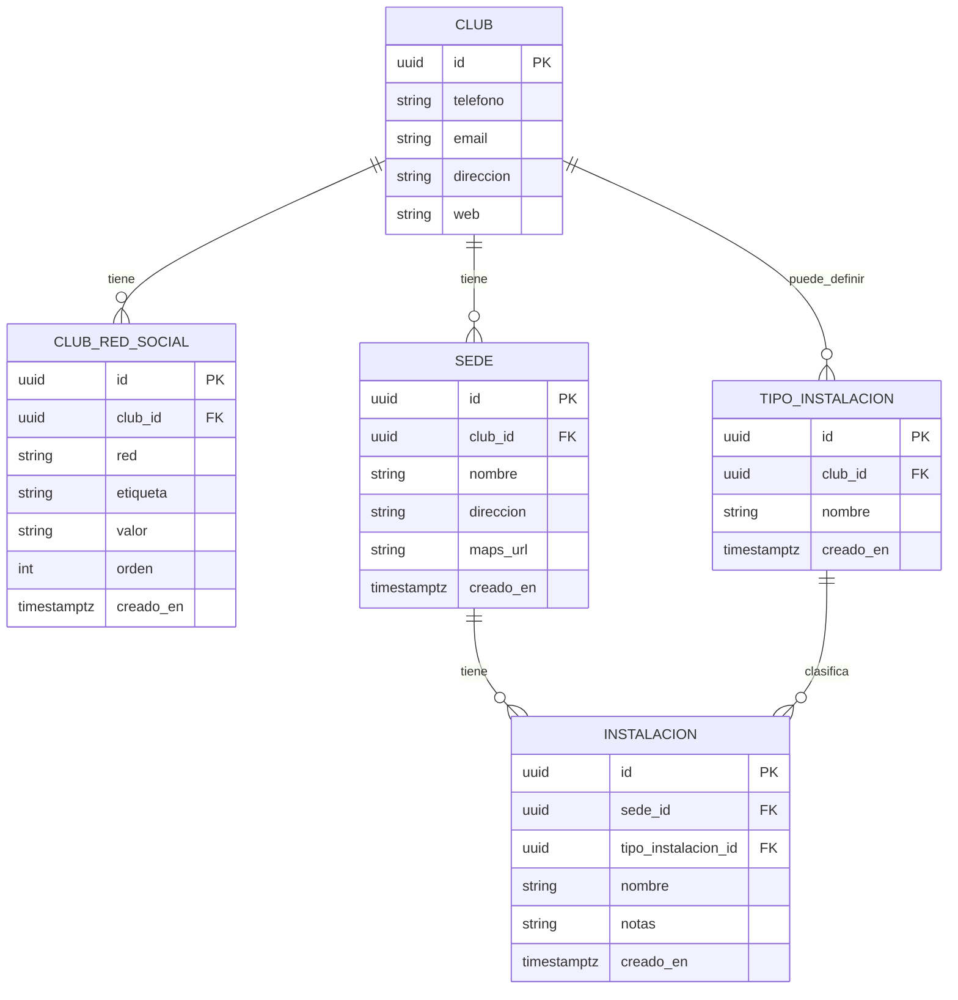

# Sedes e instalaciones (y datos de contacto del club)

Propuesta. Todavía no está implementada en la app real ni hay migración: primero se aprueban los mocks.

## Objetivo

Que un club pueda cargar sus datos de contacto (teléfono, email, dirección, web y redes sociales) y sus sedes, con las instalaciones de cada una. Lo editan el Admin del club y el Super Admin.

## Mocks (para aprobar)

Viven en `/mocks/roles`, con datos de ejemplo genéricos (Club de ejemplo del Norte). Ningún club real —tampoco Los Cardos— aparece fijo. No hay login real ni escritura en la base.

| Pantalla | Ruta |
| --- | --- |
| Datos del club (estética + contacto y redes) | `/mocks/roles/clubes/[slug]/club` |
| Contacto vacío | `/mocks/roles/clubes/[slug]/club?vacio=1#contacto` |
| Lista de sedes | `/mocks/roles/clubes/[slug]/sedes` |
| Lista de sedes vacía | `/mocks/roles/clubes/[slug]/sedes?vacio=1` |
| Nueva sede | `/mocks/roles/clubes/[slug]/sedes/nueva` |
| Detalle / edición de una sede (mapa e instalaciones) | `/mocks/roles/clubes/[slug]/sedes/[sedeId]` |
| Agregar instalación | `/mocks/roles/clubes/[slug]/sedes/[sedeId]/instalaciones/nueva` |

El menú del admin, en los mocks, suma el ítem «Sedes» (junto a Club y Admins). El cajón ☰ se usa por debajo de `lg`. Las pantallas del club llevan el tema de ejemplo (no el naranja de producto).

## Decisiones (mocks, pendientes de aprobación de la implementación)

- El 17/11/2026 14:39–14:43 Jerónimo pidió los datos de contacto del club y las sedes con instalaciones. Todos los campos de contacto son opcionales y los editan el Admin del club y el Super Admin: teléfono, email, dirección, web y una lista dinámica de redes sociales. En las redes se elige la red (Instagram, Facebook, X, YouTube, TikTok, WhatsApp, LinkedIn u otra, con URL o usuario), y se pueden agregar, quitar y reordenar (17/11/2026 14:39–14:43).
- Un club tiene muchas sedes. Cada sede tiene nombre, dirección y ubicación por un link de Google Maps. La vista previa del mapa lee las coordenadas del link y muestra un pin; en los mocks el mapa es un placeholder estático, sin API ni claves. Un link corto (maps.app.goo.gl) no se puede resolver sin red (17/11/2026 14:39–14:43).
- Cada sede tiene instalaciones. Cada una tiene un tipo, un nombre (por ejemplo «Cancha 1») y notas opcionales. Hay una lista de tipos de base (cancha de rugby, cancha de hockey, cancha de tenis, cancha de fútbol, house, pileta, gym, vestuario, quincho, salón y otra) y el club puede agregar tipos propios (17/11/2026 14:39–14:43).
- Todavía no se implementa en la app real ni se aplica una migración. Este documento deja el DER propuesto, a la espera de la aprobación de los mocks (17/11/2026 14:39–14:43).

## DER propuesto (no aplicado)

Borrador para cuando se aprueben los mocks. No se toca `docs/der-el-club.mmd` ni se corre ninguna migración hasta esa aprobación.

Opciones para el contacto: se puede guardar en columnas opcionales de `club` (más simple, es 1 a 1) o en una tabla `club_contacto`. La propuesta recomienda **columnas en `club`**.

- `club.telefono`, `club.email`, `club.direccion` y `club.web`: todos nullable. Alternativa: tabla `club_contacto` 1:1 con las mismas columnas.
- `club_red_social.red`: `instagram`, `facebook`, `x`, `youtube`, `tiktok`, `whatsapp`, `linkedin` u `otra`. `etiqueta` se usa cuando la red es `otra`. `valor` es la URL, el usuario o el número. `orden` define la lista.
- `sede.maps_url`: el link de Google Maps. Las coordenadas se pueden parsear al mostrar (y, si hace falta, cachear después en `lat`/`lng`). No se guarda una clave de API.
- `tipo_instalacion.club_id` es **nullable**: `null` son los tipos de base (compartidos por todos los clubes); un `club_id` indica un tipo propio de ese club.
- `instalacion` pertenece a una sede y apunta a un tipo. `nombre` distingue, por ejemplo, «Cancha 1». `notas` es opcional.
- Permisos (cuando se implemente): el Admin solo opera sobre su club; el Super Admin, sobre cualquiera. Un Admin del club A no edita el club B.

## Criterios de aceptación (cuando se implemente, después de aprobar mocks)

- Un Admin o un Super Admin puede cargar y editar el contacto y las redes de su club, todos opcionales, con redes de la lista o «Otra», y reordenarlas.
- Un club puede tener varias sedes, cada una con nombre, dirección, link de Maps y vista previa del pin cuando hay coordenadas.
- Cada sede lista sus instalaciones, se puede agregar una eligiendo un tipo de base o uno propio, con nombre y notas opcionales.
- La migración es idempotente, se aplica solo en desarrollo, y el DER oficial se actualiza en el mismo commit.
- No hay clubes reales hardcodeados ni claves de Google Maps en el repo.
